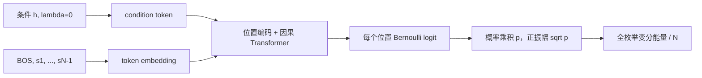

# 第 12 题考核对照与实际学习记录

来源：本地《期末考核，研究选题手册(1).pdf》第 1–3、26–27 页；全文提取并目视核对第 26–27 页。
课程评分：研究报告 60%，汇报/答辩 40%；页数、答辩时长和日期遵照教师通知，本仓库不擅自设定。

## 原题到本轮实现

| 要求 | 本轮路径/处理 | 边界 |
|---|---|---|
| 4–6 自旋开放 Ising 链 | `src/ctqs/physics.py`；N=4/6 测试，N=6 训练 | N=8 仅谱机制附加检查 |
| 因果自回归、关闭 dropout | `src/ctqs/models.py`，`tests/test_models.py` | 每一步预测二值自旋；不是时间序列 |
| 多 h 变分能量训练 | `scripts/run_round1.py`，每自旋能量等权平均 | 不使用精确振幅监督，不声称复现完整 TQS |
| 冻结 train/validation/内插/外推 | `experiments/configs/round1.json` | 三 seed 初筛；旧预研究已影响选题，非历史盲测 |
| 验证集停止/选 checkpoint | 每50步按验证变分能量选择 | 最终测试前冻结，不根据保真度调参 |
| 查表内插/边界参照 | `physics.lookup`，与网络共享已学训练态 | 不放入测试精确态、不另行训练 |
| 每自旋能量误差/F/观测量 | 各 run `metrics.json` | Z1 与端到端连通关联，保留各点、各 seed |
| 参数轴、多 h 曲线、重复次数 | `scripts/summarize_round1.py` | 显示 seed SD，不冒充置信区间 |
| 沿用/简化/改动对照 | 下表 | 明确原文对称性设置 |
| PDF 报告和可复现材料 | 本轮报告、代码、锁定版本、manifest、图表 | 本轮报告不是 ICLR 投稿终稿 |
| 过程/分工/AI 披露 | `docs/handoffs/issue-1.md` 及报告 | 人类成员尚需填写自己的贡献和核查 |
| 答辩 | 以下问题供准备 | Agent 无法替代成员实际理解/汇报 |

| 沿用原文 | 本组简化 | 本轮研究改动 |
|---|---|---|
| 参数条件、自回归乘积、因果注意力、位置编码、能量训练 | 固定 N=6、正实振幅、全枚举64构型、一个 encoder block；condition=(h,0) | 加入同训练态查表；分解训练失败与泛化；普通/正宇称训练；谱隙与 Ritz 反例 |
| 多哈密顿量共享权重 | 不预测相位/尺寸；固定3个 h 而非原文联合参数分布采样 | 统一 updates 和 H-action 预算，报告实际 wall time |

## 原文方法：用自己的推导解释

必读入口：[Zhang & Di Ventra, arXiv v4](https://arxiv.org/html/2208.01758v4)，对应 Fig.1、Eq.(1)、Fig.2/4 和 Appendix D/G.2。

本轮网络流程：

输出 s_i 的位置只可见条件 token、BOS 和 s_1,...,s_(i-1)。同时有右移与因果 mask，避免真实 s_i 泄漏到自身预测。
Bernoulli 单 logit 与二分类 softmax 等价；原始态概率逐条件相乘，归一化来自链式求和，不来自全向量再归一化掩盖错误。
训练与评估都 dropout=0。正宇称训练是另一个明确标记的变分基准：对原始振幅做 (psi+Ppsi) 并在全枚举下归一化；它不是原始自回归分布的无代价采样实现。

两个自旋手算：p(s1=0)=0.6，p(s2=0|s1=0)=0.7，p(s2=0|s1=1)=0.2。
于是 p(00,01,10,11)=(0.42,0.18,0.08,0.32)，总和1；p(s2=0)=0.5，p(00)=0.42 不等于0.6×0.5，故归一化自回归也能表示关联。

本组假设：低 h 的错误不只随最近训练点距离变化，低能隙也会使能量训练难以分辨量子态。
可否定方式：若训练点始终准确、已知宇称基准无效而距离关系稳健，当前解释不获支持；若在距离为0的训练点已失效，应先承认训练问题。

## 答辩前每位成员需能回答

1. 给出一个位置的可见 token，说明去掉右移或掩码会发生什么。
2. 用两自旋条件概率证明归一化，解释正实振幅为何只覆盖当前特定基态族。
3. 为什么全局小能量误差不保证 F 很高？哪些条件下偶宇称扇区内谱隙可替代全空间谱隙？
4. 查表和直接网络分别使用哪些信息？为什么不能以测试点再优化后的结果声称零样本泛化？
5. 指出一幅图中的训练点、seed 数、误差条含义和不能支持的结论。
6. 原文多尺寸/采样/对称性与本组改编区别是什么？

这份文字由 Codex 辅助整理，未冒充成员的手写学习日志或已完成答辩。成员应补充实际阅读、修改与核查记录。
