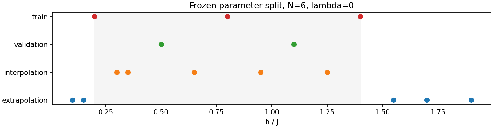
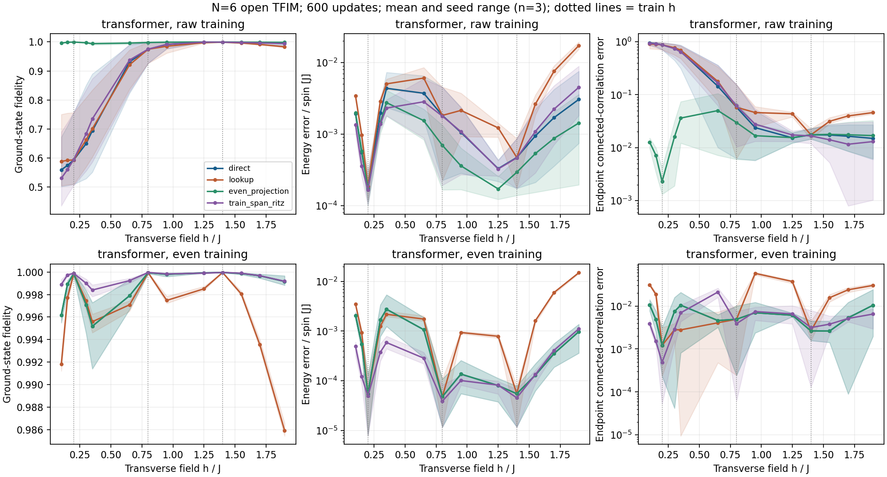
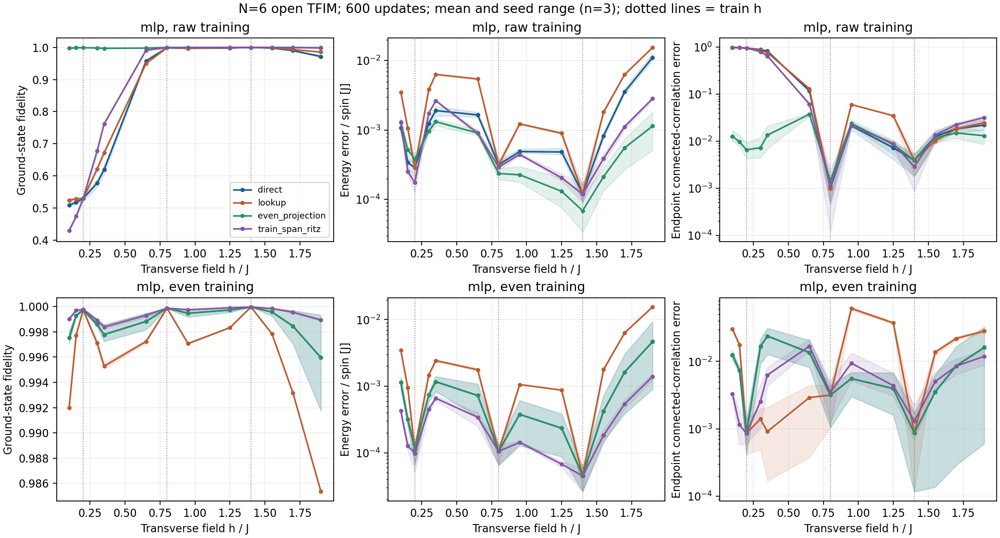

# 条件 Transformer 量子态：先区分训练失败，再研究泛化

第一轮研究报告 / 2026-10-19 / Issue #1

Research title: Separating Training Failure from Generalization Error in Conditional Neural Quantum States

## 摘要与证据等级

本轮围绕课程第12题，建立了小系统条件自回归量子态的可复现基准，补齐同一已学训练态的查表对照，并检验低能量误差是否足以支持高保真泛化。我们运行两种架构、两种训练方式、三个初值共12组实验；全部采用6自旋开放TFIM、600次更新、冻结参数划分和验证能量选检查点。普通MLP在已训练横场h=0.2处仅得到0.5214–0.5350的保真度，正宇称约束训练提高到0.999675–0.999876。约束后的Transformer在三个初值的外推网格平均失真上均优于查表，但内插有一个初值更差。二维宇称Ritz有时降低能量却选择错误扇区。

这些结果支持在该有限预算算例中将训练状态错误与参数泛化分开诊断。它们不构成新算法优势、完整TQS复现或ICLR级论文的证明。谱机制属于标准推导；当前工作是带有负面结果的初筛研究报告，正式共识仍待另一成员独立复现。

## 1. 从原题到可检验问题

课程要求以4–6自旋开放链、正实自回归振幅、多横场变分能量为基础，比较未见横场的内插与外推；必须检查归一化/因果性，并以冻结模型的训练态内插和区间外边界态作参照。精确对角化仅用于评价与程序核查。

我们检验的假设是：低场错误不只是“距训练点远”造成，近简并下能量目标也可能不能有效分辨错误态。替代解释包括容量不足、优化预算不足、共享条件拟合不足和数据覆盖不足。若训练点自身已失败，就不能把该误差全部称为泛化失败；若直接网络不能超过同源查表，则也不足以证明有用的条件关系。

| 沿用原文 | 本组简化 | 本轮改动 |
|---|---|---|
| 条件自回归、位置编码、因果注意力和变分训练 | 固定N=6、一个编码层、无相位头、64构型全枚举 | 补齐查表；普通/正宇称训练对照；加入两类Ritz基准 |
| 多哈密顿量共享权重 | 3个固定h、等权平均每自旋能量、CPU float64 | 冻结验证选检查点和测试划分，保存全部种子 |

原论文TQS在TFIM中已使用对称性，且报告过未训练区域的相变误判。因此无对称小网络的失败不能被归结为原论文方法失效，更不能把正宇称投影作为本组的新算法。[1]

## 2. 模型、归一化与对照

H(h)=-sum_i Z_i Z_(i+1)-h sum_i X_i，开放边界，J=1，比特串左端为最高位，Z|0>=+|0>。h>0时此模型的唯一基态可取严格正实振幅；这不覆盖一般复相位或带符号量子态。

网络流程是：条件token (h,0) 与 BOS、右移自旋序列 → 嵌入和位置编码 → 因果Transformer → 每个位置的Bernoulli logit → 条件概率乘积p → psi=sqrt(p)。一个16维、2头、32维前馈层的Transformer有2449个参数；两层32宽的自回归MLP有1569个参数。所有dropout恒为0。

预测s_i时只能读取条件、BOS及s_1到s_(i-1)。例如p(s1=0)=0.6，p(s2=0|0)=0.7，p(s2=0|1)=0.2，得到p(00,01,10,11)=(0.42,0.18,0.08,0.32)，既归一化也能有关联。实际单元测试穷举N=4/6，并翻转当前位置及所有未来自旋，验证此前条件输出不变。

普通训练直接使用自回归振幅。正宇称训练使用归一化的psi+Ppsi，其中P翻转全部自旋；这是显式全枚举变分基准，其投影后的采样成本不等同于原始自回归模型。两种训练的主要目标均为训练点平均每自旋能量。

评价包括direct、lookup、even_projection、parity_ritz和train_span_ritz。查表使用同一冻结网络在三个训练h的振幅，区间内线性插值后归一化，外部保持最近边界态。Ritz只使用模型态及目标H，无精确态；记录额外H作用。它是已知子空间方法的对照，不是新的贡献。[3–5]

## 3. 冻结实验与资源

训练h={0.2,0.8,1.4}，验证h={0.5,1.1}，内插h={0.3,0.35,0.65,0.95,1.25}，外推h={0.1,0.15,1.55,1.7,1.9}。初值为17、29、43。Adam学习率0.005，每个任务完整运行600步，每50步根据验证变分能量选检查点。ED保真度、精确基态和精确能隙都不参与训练或选择。

每次训练1800次训练H作用，24次验证H作用；两架构更新数与H作用数相同，但参数量、前向成本与壁钟时间并不相同，因此不作架构效率排名。12组主要任务共7200次优化更新，记录的运行段壁钟总和24.625秒，不包含环境安装、单元测试、工具启动和整个研究会话；首个任务还含优化器初始化开销。实际运行环境为Python 3.13.9、PyTorch 2.14.1+cpu、NumPy 2.3.5、SciPy 1.16.3，使用CPU，PyTorch线程数1，未使用本机GPU。

源代码commit为3ef2378429d628772fd5a7935d1b1112122c9da7；每个manifest记录配置、种子、命令与成本。主分析只包含预先指定的12组，不按结果删种子。另有一个同机确定性重跑，不计入统计样本。

## 4. 结果：先看训练点，再看未见点

普通MLP在训练点h=0.2的每自旋能量误差为0.000212–0.000335，但F仅0.5214–0.5350，端到端连通关联误差约0.955–0.958。训练点距离为0，已能排除“所有错误都由外推距离造成”的解释。正宇称训练后，该点F为0.999675–0.999876。

普通Transformer在该点F为0.5144、0.5091、0.7563；正宇称训练后为0.999646、0.999981、0.999946。这个对照支持错误扇区混合对该设置的重要影响，但没有排除更长训练、其他优化器或模型宽度能改善普通网络。

下表为正宇称训练的平均失真1-F；先在每个种子的固定网格求均值，再跨三个种子报告均值和样本标准差。标准差不是置信区间。

| 架构/区域 | 直接预测 | 同源查表 | 训练态空间Ritz |
|---|---|---|---|
| MLP / 内插 | 0.001114 ± 0.000426 | 0.002990 ± 0.000101 | 0.000745 ± 0.000076 |
| MLP / 外推 | 0.001835 ± 0.001210 | 0.006785 ± 0.000047 | 0.000584 ± 0.000010 |
| Transformer / 内插 | 0.002022 ± 0.001360 | 0.002778 ± 0.000312 | 0.000727 ± 0.000243 |
| Transformer / 外推 | 0.001240 ± 0.000327 | 0.006582 ± 0.000050 | 0.000523 ± 0.000093 |

Transformer外推的三个配对差值（direct失真减lookup失真）均为负：-0.004923、-0.005477、-0.005624。内插则为+0.000441、-0.001508、-0.001203，说明内插优势不跨全部初值成立。更强的训练态空间Ritz在上述均值指标上更好，但需要额外矩阵元计算，不能视为免费改进或普遍支配。

完整数据包含900行指标与60组汇总，保留训练、验证、内插、外推和五种预测方式。没有将相邻h点当作独立重复，也没有计算不适合三种子的显著性结论。

## 5. 机制推导与反例

设H有唯一基态，谱隙Delta=E1-E0>0，归一化psi的F=|<0|psi>|²。谱分解直接给出epsilon=<H>-E0 >= Delta(1-F)。当Delta很小时，能量准确并不自动带来有效保真度保证。若psi严格限制在包含基态的不变扇区，可改用扇区内谱隙；错误投影或对称性破缺时不可套用。

本轮独立谱计算在N=6,h=0.2得到全空间Delta=0.000122880003，偶扇区内Delta_plus=1.670819984；N=8,h=0.2则分别为0.0000049152与1.639901813。这是有限尺寸机制数据，不是渐近标度结论，也未作为选点信息。

对H=diag(0,delta)、psi=(0,1)，方差为0而F=0。因此残差为零不能确认基态身份。对(|0>+|1>)/sqrt(2)，F=1/2、epsilon=Delta/2、variance=Delta²/4，近简并混合态也可能通过绝对阈值诊断。上述是标准反例，并非新定理。

若近似偶/奇态的扇区内部误差为e_plus/e_minus，Ritz在e_plus-e_minus>Delta时会选奇态。其能量更低而与真实偶基态正交，并不违反变分原理。本轮普通MLP在h=0.2的三个种子全部出现parity-Ritz保真度约0；不能只用后处理能量收益作为可靠性证书。

## 6. 文献排查如何改变后续研究

条件化NQS、FNQS、对称投影、Lanczos和参数态子空间都已有文献基础。[1–5] 本轮额外检索到Sarkar与Lee的主动自学习EC，以及2026年FNEH预印本。后者直接涉及以FNQS参数态构造有效哈密顿量，因此“网络加Ritz”尤其不能当作首创。[4–5]

另一个必须加入的对照来自模型本身：PH(h,lambda)P=H(h,-lambda)。前期报告中负纵场外推可用已知参数协变关系构造廉价基准；其失败不是新方法必需性的充分证据。

基于本轮证据，下一阶段建议检验“在训练点解不精确且可能处于错误分支时，预算应投入新增参数点，还是投入已有点的状态修复”。这是候选问题，尚未证明新颖、可解决或具有ICLR价值。不能先宣布一个新主动学习方法，再用有利网格证明它。

## 7. 下一轮实验与停止门槛

- 先由另一成员重跑本轮一个完整种子并核对所有指标，随后补充更多初值和600/1200/2400步预算曲线，判断优化未收敛的影响；旧测试点此后作为开发基准，不再标榜新盲测。
- 在新的lambda双侧训练/测试区域比较uniform、log/mixed、random、residual-greedy；新增点、候选扫描、继续优化和子空间后处理均计入成本。
- 先加入P协变预测基准，再考虑无相同符号协变捷径的第二哈密顿量族。不得把对称性已解的问题包装为新采样贡献。
- 把主动策略与EC/FNEH风格基准、固定网格和“同预算继续训练”比较。至少分别报告wall time与H作用数，不把相同步数当相同成本。
- 若改进被廉价对称性/查表/子空间基准解释，或只在ED谱信息辅助下成立，则停止新算法优越性叙事。可保留机制基准成果，但需另证社区价值。

## 8. 可复现性、局限与考核完成边界

10项测试全部通过，覆盖独立Kronecker哈密顿量、参数协变、退化子空间、Ritz秩与变分界、因果性、归一化、能量梯度有限差分。Transformer正宇称seed17另开一次运行，75条指标和12条训练日志与首轮精确一致。这只是同机重跑，不是不同研究者的独立复现。

本轮未完整重跑两份历史ZIP，未实现主动选点训练，未训练第二物理族，也未验证大系统采样。只有一个N=6、一组超参数和三个初值；全枚举费用随N指数增长。简单谱推导和已知对称性基准不能满足新方法的创新要求。按照ICLR关于问题、证据、正确性、复现和贡献价值的标准，当前尚不具备主会投稿成熟度。[6]

复现入口：安装requirements-research.txt与CPU PyTorch；运行python -m unittest discover -s tests -v；运行python scripts/run_round1.py；生成图表使用python scripts/summarize_round1.py。原始主分析run清单在experiments/round1_index.json；新复跑产生独立目录，不能悄悄替换原分析种子。

环境故障也已记录：最初系统Anaconda的MKL与PyTorch OpenMP冲突，改用项目内NumPy/SciPy wheel解决，未使用允许重复OpenMP运行库的强行绕过；未改系统代理。PDF可由scripts/build_round1_pdf.py和reportlab重建，默认使用Windows宋体，可通过--font指定可用CJK字体。

本轮已交付课程要求的研究报告初稿、文献学习材料、代码/参数/指标/图和过程记录。三位成员的实际学习、人工核验、分工填写及口头答辩仍须本人完成。AI披露：Codex用于文献定位、代码、执行、分析与报告整理；没有代填人类审阅或实验贡献。仓库现有STATE中的正式科学结论未因此升级。

## 参考资料

[1] Zhang & Di Ventra. Transformer Quantum State: A Multi-Purpose Model for Quantum Many-Body Problems. PRB 107, 075147 (2023). https://arxiv.org/html/2208.01758v4

[2] Rende et al. Foundation neural-networks quantum states as a unified Ansatz for multiple hamiltonians. Nature Communications 16, 7213 (2025). https://www.nature.com/articles/s41467-025-62098-x

[3] Chen et al. Systematic improvement of neural network quantum states using Lanczos. NeurIPS 2022. https://papers.neurips.cc/paper_files/paper/2022/hash/3173c427cb4ed2d5eaab029c17f221ae-Abstract-Conference.html

[4] Sarkar & Lee. Self-learning Emulators and Eigenvector Continuation. PR Research 4, 023214 (2022). https://arxiv.org/html/2107.13449v2

[5] Zhang, Jiang & Luo. Foundation Neural Effective Hamiltonian for Strongly Correlated Quantum Materials. arXiv:2608.14208v1 (2026), preprint. https://arxiv.org/html/2608.14208v1

[6] ICLR 2026 Reviewer Guide. https://iclr.cc/Conferences/2026/ReviewerGuide
